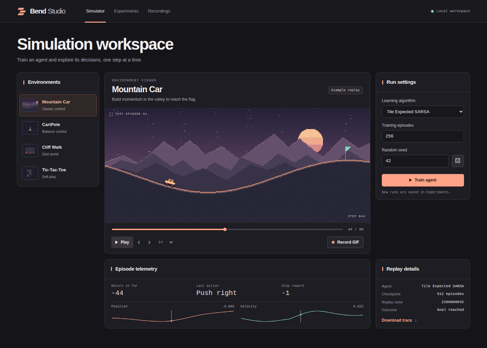

# Bend Agent Studio

Train reinforcement-learning agents in Bend and watch how their decisions change. The local Studio opens with a playable episode. You can scrub through each move, inspect rewards, change learners, and keep a recording of a trained policy.

A separate [Gymnasium adapter](integrations/gymnasium/README.md) lets Python agents play the same JSON finite and grid worlds without changing Studio or its dependencies. Seven [toy-text benchmark worlds](EXPERIMENTS.md#benchmark-worlds) include FrozenLake, Taxi, CliffWalking and Blackjack. See [large-world compile measurements and replay checks](tools/finite-layout/README.md).

## Start Studio

See the [studio guide](docs/studio.md).

### If Studio stops during training

See [Studio interruption and recovery](docs/studio.md#if-studio-stops-during-training).

## Design an experiment

See the [experiments guide](docs/experiments.md).

## Repository layout

Studio starts in [studio/server.mjs](studio/server.mjs). The root [experiment CLI](experiment.mjs) runs studies; the [batch CLI](batch.mjs) works with offline datasets. Their implementations live in [core/](core/) and [offline/](offline/). Look in [worlds/](worlds/) for environments, [agents/](agents/) for learners, [experiments/](experiments/) for runnable plans, and [analysis/](analysis/) for reporting scripts.

Two standalone Bend programs serve different purposes:

- Run `bend examples/main.bend` for a small two-door example that prints the bandit's held-out score before and after training. [Its learner](examples/bandit.bend) is a helper, not a second entry point.
- Run `bend checks/benchmark.bend` to print a CSV header plus 100 data rows: five worlds × four algorithms × five seeded replicates. This produces benchmark data; it is not the pass/fail [benchmark check](checks/benchmark_checks.bend) or a Studio study archive.

## Formal Properties

See the [laws guide](docs/laws.md).

## Run the checks

See the [testing guide](docs/testing.md).

## Guides

- [Experiments](docs/experiments.md)
- [Worlds](docs/worlds.md)
- [Agents](docs/agents.md)
- [Analysis](docs/analysis.md)
- [Offline](docs/offline.md)
- [Testing](docs/testing.md)
- [Studio](docs/studio.md)
- [Laws](docs/laws.md)

### Agent access over MCP

See [Agent access over MCP](docs/agents.md#agent-access-over-mcp).
