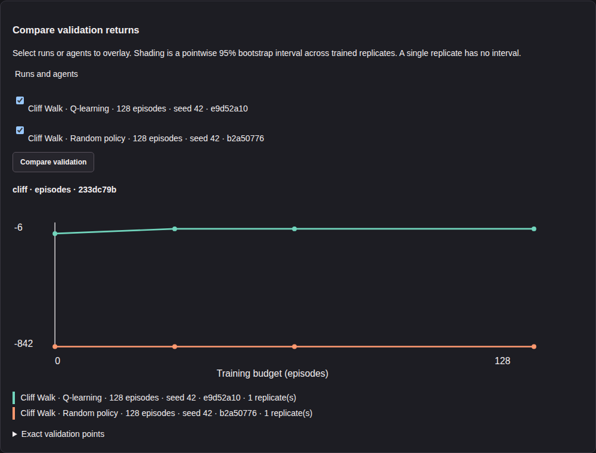

# Bend Agent Studio

Train reinforcement-learning agents in Bend and watch how their decisions change. The local Studio opens with a playable episode. You can scrub through each move, inspect rewards, change learners, and keep a recording of a trained policy.

A separate [Gymnasium adapter](integrations/gymnasium/README.md) lets Python agents play the same JSON finite and grid worlds without changing Studio or its dependencies. Seven [toy-text benchmark worlds](EXPERIMENTS.md#benchmark-worlds) include FrozenLake, Taxi, CliffWalking and Blackjack. See [large-world compile measurements and replay checks](tools/finite-layout/README.md).


## Start Studio

Install Node.js 24 or newer, open a terminal in this directory, and run:

```sh
npm start
```

Open **http://127.0.0.1:4173**. The four included replays work immediately. Studio uses only Node's standard library and browser APIs.

For training, install [Bend 2.0.40](https://github.com/bendlang/bend/releases/tag/v2.0.40) and check that `bend version` prints `bend 2.0.40`. If the executable lives elsewhere, start Studio with `BEND=/path/to/bend npm start` on macOS or Linux. In PowerShell, set `$env:BEND` to the executable path before running `npm start`.

| Environment | What to watch | Available agents |
| --- | --- | --- |
| Mountain Car | The car builds momentum on both slopes to reach the flag. | Tile Expected SARSA, tile Q-learning, coarse Q-learning, random |
| CartPole | The cart corrects the leaning pole until it falls or reaches the 500-step limit. | Neural actor–critic, linear actor–critic, random |
| Cliff Walk | A fall costs 100 reward and returns the walker to the start. | Q-learning, Expected SARSA, Dyna-Q, random |
| Tic-Tac-Toe | A policy plays both seats on the same physical board. | Negamax Q-learning, Expected TD, Monte Carlo, random |

Six more discrete learners are available through CLI experiment plans: [sampled SARSA(0)](agents/sarsa/README.md), [n-step expected TD](agents/n_step/README.md), [expected TD(λ)](agents/td_lambda/README.md), [REINFORCE with a state baseline](agents/reinforce/README.md), [sparse linear Q-learning](agents/linear/README.md), and [tiny clipped policy gradient](agents/clipped_pg/README.md).

1. **Watch an example.** Choose a world and press **Play**. Use the timeline, step buttons, or speed selector to inspect the episode. Telemetry follows the selected step.
2. **Train an agent.** Pick a learning algorithm, episode budget, and seed. Select **Train agent**. If you stay in the simulator without changing the replay, the completed run opens on a held-out test episode. Otherwise, open it from **Experiments**. To stop early, open **Experiments** and choose **Cancel training** on that run.
3. **Inspect a checkpoint.** In **Experiments**, choose **Open replay**. Select a checkpoint, replicate, evaluation split, and episode. Validation is available at intermediate checkpoints. Test episodes use the final checkpoint.

**Training queue.** Submit more jobs while one trains. Up to 32 waiting jobs are stored in FIFO order; their positions and cancel buttons appear in **Experiments**. Cancelling a waiting job never starts it or stops the active run. At normal shutdown or after a crash the active job is interrupted, not rerun. Reopening the same Studio home resumes the remaining queued jobs in order, only after the prior supervisor has released ownership. A leftover ambiguous ownership marker still blocks training until reviewed. Recovered jobs rebuild their plans from validated catalog settings.

**Compare validation returns.** In **Experiments**, select up to eight run/agent combinations and choose **Compare validation**. Curves overlay only for the same sealed game specification and budget unit; check simulator revisions before comparing runs from different toolchains. The line is the mean of the per-replicate validation episode means. Shading is a deterministic, pointwise 95% percentile bootstrap over separately trained replicates (1,000 draws), not evaluation episodes or a joint confidence band. With one replicate only a line is shown. **Exact validation points** exposes the plotted numbers. A damaged selection reports its own error without suppressing healthy curves.



The read-only local endpoint `GET /api/runs/:id/summary` reads the sealed manifest and checkpoint chains, without executing archived code, replaying episodes or changing the run. It is a validation-return view, not a substitute for full `verify`. Readers are isolated from the HTTP event loop (two at once); a run is limited to 8,192 checkpoint rows, 64 MiB of inputs and a 20-second read. Use offline export/analysis for larger studies.

4. **Keep a recording.** **Record GIF** renders the entire episode at the selected speed, even while playback is paused. Open **Recordings** to preview or download the animation. **Download trace** exports the observations, legal actions, choices, rewards, and stop flags as JSON.

The browser saves recordings locally for the Studio address you used. Download a GIF for a portable copy. Studio saves training runs under `.bend-studio/`. Set `BEND_STUDIO_HOME` to choose another location. To use another port, run `npm start -- --port 4180`. The server binds to the loopback interface.

### If Studio stops during training

A separate training process holds an exclusive SQLite lock on the Studio home. If the server crashes or is force-quit, its private connection closes. The training process stops its JavaScript worker and its Bend compiler, removes temporary build files, and releases the lock. On restart, Studio marks unfinished training as **interrupted** and keeps completed checkpoints. A second Studio using the same home waits up to five seconds for cleanup. Use a different home to run two instances side by side.

Use a local filesystem with working SQLite file locks, and point `BEND` directly at the compiler. If the training supervisor itself is forcibly terminated, a compiler may survive. Studio keeps existing runs available but blocks new training while `training-active.json` remains in the Studio home. Verify that the previous training and compiler have stopped before removing that file. An older run still marked as training at upgrade gets the same protection. Stop earlier Studio versions before opening their home with this version. Independent processes launched by custom compiler wrappers are outside this supervision. A restart never uses a saved PID to terminate a process.

## Design an experiment

See the [command reference](docs/commands.md) for CLI purposes and examples.

The commands below use Node 24 or newer and Bend 2.0.40; the analysis step also requires Python 3 (standard library only). Run them from the repository root.

The visual presets train one model and evaluate eight episodes per split. For comparisons across independently trained models, use an experiment manifest. Bend owns the world, model, policy and update rule. The Node runner schedules replicates, keeps seed blocks disjoint, freezes models during evaluation, and stores immutable checkpoints.

```sh
node experiment.mjs run experiments/bridge.json runs/bridge
node experiment.mjs verify runs/bridge
node experiment.mjs export runs/bridge > bridge.csv
python3 analysis/analyze.py bridge.csv --reference random
npm start -- --run runs/bridge
```

Use `--run` to open a trusted, locally generated study in Studio. Replays execute the runner stored with that study and require its recorded Node version. Custom environments display their public observations and action telemetry. The four featured environments have dedicated renderers.

An **Attached run** may be unfinished. Studio shows the planned checkpoints but checks replay availability when you request one. If the final checkpoint is missing, select an earlier saved checkpoint and **Validation**. Use `node experiment.mjs status RUN` to see progress and `node experiment.mjs verify RUN` after completion. Validation comparisons require complete checkpoint series.

After upgrading Node, you can keep Studio on the newer version and point it to an installed copy of the archived version. For example, run `npm start -- --replay-node /path/to/older/node`. Studio checks the executable’s version and uses it for matching runs. Repeat the option for additional versions. If a runtime is missing, the replay error identifies the version you need.

If the path passed to `--replay-node` is missing or cannot run, correct it before restarting Studio. You can also omit the option to inspect or compare the saved checkpoints without replaying them.

Studio runs up to two replay processes at once. A third request receives HTTP 429 and can be retried when a slot opens. Closing the replay dialog or disconnecting the client cancels its pending replay. Each runner has 30 seconds to return a trace before Studio stops it and responds with HTTP 504. Set `BEND_STUDIO_REPLAY_TIMEOUT_MS` to a positive number of milliseconds at startup for longer studies.

Start with [worlds/bridge.json](worlds/bridge.json) for a finite game, [worlds/inventory.bend](worlds/inventory.bend) for a custom Bend world, or [agents/ucb/agent.bend](agents/ucb/agent.bend) for a learning algorithm. The [experiment guide](EXPERIMENTS.md) covers authoring, offline learning, evaluation, and resuming studies. It also explains how to [regenerate the three Tiger worlds](EXPERIMENTS.md#regenerate-the-tiger-worlds).

## Repository layout

Studio starts in [studio/server.mjs](studio/server.mjs). The root [experiment CLI](experiment.mjs) runs studies; the [batch CLI](batch.mjs) works with offline datasets. Their implementations live in [core/](core/) and [offline/](offline/). Look in [worlds/](worlds/) for environments, [agents/](agents/) for learners, [experiments/](experiments/) for runnable plans, and [analysis/](analysis/) for reporting scripts.

Two standalone Bend programs serve different purposes:

- Run `bend examples/main.bend` for a small two-door example that prints the bandit's held-out score before and after training. [Its learner](examples/bandit.bend) is a helper, not a second entry point.
- Run `bend checks/benchmark.bend` to print a CSV header plus 100 data rows: five worlds × four algorithms × five seeded replicates. This produces benchmark data; it is not the pass/fail [benchmark check](checks/benchmark_checks.bend) or a Studio study archive.

## Formal Properties

The <!-- count:core-laws -->46<!-- /count --> core laws are stated in [laws/LAWS.bend](laws/LAWS.bend) and proved in [laws/PROOF.bend](laws/PROOF.bend). The learners declare <!-- count:learner-laws -->15<!-- /count --> additional laws in their own modules:

| Learner | Statements | Proofs |
| --- | --- | --- |
| SARSA | [Laws](agents/sarsa/laws.bend) | [Proofs](agents/sarsa/proof.bend) |
| n-step TD | [Laws](agents/n_step/laws.bend) | [Proofs](agents/n_step/proof.bend) |
| TD(λ) | [Laws](agents/td_lambda/laws.bend) | [Proofs](agents/td_lambda/proof.bend) |
| REINFORCE | [Laws](agents/reinforce/laws.bend) | [Proofs](agents/reinforce/proof.bend) |
| Sparse linear Q-learning | [Laws](agents/linear/laws.bend) | [Proofs](agents/linear/proof.bend) |
| Clipped policy gradient | [Laws](agents/clipped_pg/laws.bend) | [Proofs](agents/clipped_pg/proof.bend) |

- **Learning.** The engine applies the learner once per training transition and preserves the model during evaluation. The whole-rollout counting-learner laws prove evaluation freezes the counter and training changes it by exactly the accepted-step delta; the proof preserves the signed difference from an arbitrary starting counter. Updating one Double Q table preserves the other. With a nonempty legal-action list, Double Q selects the bootstrap action with the table being updated and values it with the other table. Dyna planning preserves recorded experience. Completing a Monte Carlo self-play episode clears its buffered decisions, not the learned table.
- **Episode completion.** A training report applies the optional finish callback once, without changing its score, step count or reason. Evaluation skips it; reading a completed segment again cannot apply it twice.
- **Episode boundaries.** On the engine’s actual decision path, rejecting an illegal action preserves model, score and accepted steps, produces no transition and ends the episode. Only an open view at zero remaining fuel is truncated; positive fuel never causes truncation. Each report increases the episode count by one, including illegal exits. From any starting run, the final step count is at most the initial count plus available fuel.
- **Observations and replay.** The history wrapper preserves legal actions and rewards. At each reset it restores the configured memory and seeds the underlying world anew. For any typed world and agent hooks, observing decisions preserves the final report, and splitting an interaction budget gives the same cursor as advancing once, including model, seed and remaining horizon. These laws cover both training and evaluation. With legacy identity-finish hooks, completing a fresh raw cursor yields exactly the ordinary episode report for all worlds and policies, including the model, score, steps and stop reason.
- **Sparse table updates.** The addressed observation/action key reads back the revised F32 value and its incremented U32 visit count. All other keys preserve both reads, even when a key was absent or input entries are not unique.
- **Offline logging.** Zero exploration buckets always select the preferred action, as does every masked 16-bit draw at or above the threshold. The base action is computed in evaluation mode with word zero. The propensity formula is separately tested across all 65,536 draws.

The [native runtime spike](tools/native-spike/README.md) reports sampled CPU/JS replay parity and timings; the supported backend remains JavaScript.

## Run the checks

With Bend 2.0.40 and Node 24 installed:

```sh
npm test
bend checks/checks.bend
bend checks/benchmark_checks.bend
bend checks/study_checks.bend
bend laws/PROOF.bend
```

`npm test` runs the Node checks, including public-policy oracles and generated memory worlds. If the Bend executable is absent, compiler-backed tests are marked skipped. With Bend installed, they exercise training, replay, checkpoint persistence, and offline evaluation.

For an independent proof verdict, install Lean 4.34.0 (for example, `elan toolchain install leanprover/lean4:v4.34.0`) and run `bend laws/PROOF.bend --verdict`. Bend 2.0.40 builds and caches its bundled BendTT kernel on first use. You can also set `BENDTT` to a kernel built from the same release.

### Agent access over MCP

See the [local MCP server](mcp/README.md) for typed authoring, training jobs, replay, and statistical analysis. The [field reference](mcp/FIELDS.md) covers input plans and specs. Installing the adapter does not add dependencies to the main project.

For fixed-suite comparisons, [the analyzer supports IQM, probability of improvement, and performance profiles](EXPERIMENTS.md#comparing-a-fixed-suite-of-games), with replicate bootstrap intervals and no extra dependencies. Per-game analysis remains the default.

New tabular learners index observation/action IDs with a persistent digital
search tree. Legal-list order still breaks ties. See the
[archive parity and timing procedure](EXPERIMENTS.md#compare-keyed-tabular-training-against-list-backed-archives)
for the benchmark and its limits.

Custom learners may export `finish(model: Model, reason: E.Stop) -> Model` to flush episode-local state. It runs once per training episode, never on a partial checkpoint or during evaluation. Omitting it keeps the original behavior. See [the learner lifecycle](EXPERIMENTS.md#learner-episode-completion).

For many-arm comparisons against one reference, [Holm-adjusted paired sign tests](EXPERIMENTS.md#multiple-arms-versus-one-reference) are opt-in; default mean intervals remain pointwise.

[Two-pile Nim](docs/two-pile-nim.md) is a small CLI self-play arena with an independently checked optimal policy and exact exploitability comparisons.

An optional [local Minari exporter](integrations/minari/README.md) converts collected trajectories to a reload-verified HDF5 dataset. It does not register or upload data.
