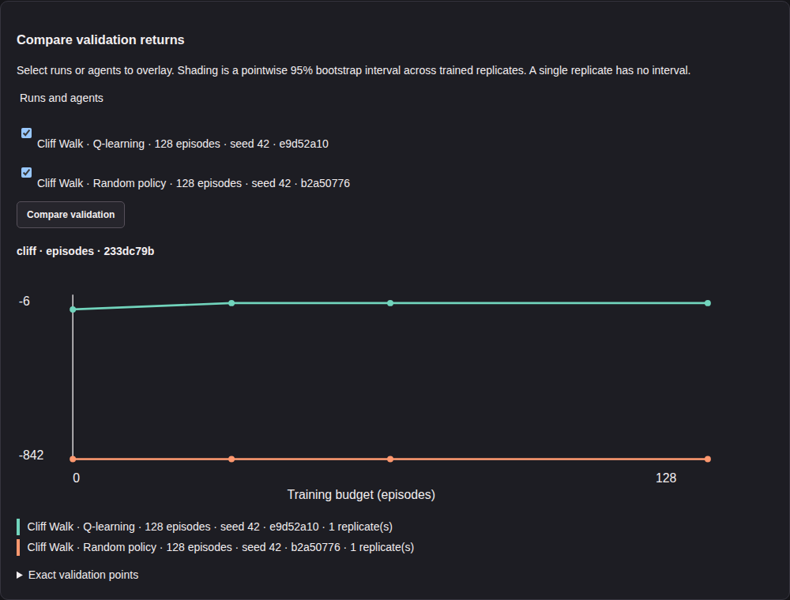

# Studio

Run shell commands from the repository root.

## Start Studio

Install Node.js 24 or newer, open a terminal in this directory, and run:

```sh
npm start
```

Open **http://127.0.0.1:4173**. The four included replays work immediately. Studio uses only Node's standard library and browser APIs.

For training, install [Bend 2.0.40](https://github.com/bendlang/bend/releases/tag/v2.0.40) and check that `bend version` prints `bend 2.0.40`. If the executable lives elsewhere, start Studio with `BEND=/path/to/bend npm start` on macOS or Linux. In PowerShell, set `$env:BEND` to the executable path before running `npm start`.

| Environment | What to watch | Available agents |
| --- | --- | --- |
| Mountain Car | The car builds momentum on both slopes to reach the flag. | Tile Expected SARSA, tile Q-learning, coarse Q-learning, random |
| CartPole | The cart corrects the leaning pole until it falls or reaches the 500-step limit. | Neural actor–critic, linear actor–critic, random |
| Cliff Walk | A fall costs 100 reward and returns the walker to the start. | Q-learning, Expected SARSA, Dyna-Q, random |
| Tic-Tac-Toe | A policy plays both seats on the same physical board. | Negamax Q-learning, Expected TD, Monte Carlo, random |

Six more discrete learners are available through CLI experiment plans: [sampled SARSA(0)](../agents/sarsa/README.md), [n-step expected TD](../agents/n_step/README.md), [expected TD(λ)](../agents/td_lambda/README.md), [REINFORCE with a state baseline](../agents/reinforce/README.md), [sparse linear Q-learning](../agents/linear/README.md), and [tiny clipped policy gradient](../agents/clipped_pg/README.md).

1. **Watch an example.** Choose a world and press **Play**. Use the timeline, step buttons, or speed selector to inspect the episode. Telemetry follows the selected step.
2. **Train an agent.** Pick a learning algorithm, episode budget, and seed. Select **Train agent**. If you stay in the simulator without changing the replay, the completed run opens on a held-out test episode. Otherwise, open it from **Experiments**. To stop early, open **Experiments** and choose **Cancel training** on that run.
3. **Inspect a checkpoint.** In **Experiments**, choose **Open replay**. Select a checkpoint, replicate, evaluation split, and episode. Validation is available at intermediate checkpoints. Test episodes use the final checkpoint.

**Training queue.** Submit more jobs while one trains. Up to 32 waiting jobs are stored in FIFO order; their positions and cancel buttons appear in **Experiments**. Cancelling a waiting job never starts it or stops the active run. At normal shutdown or after a crash the active job is interrupted, not rerun. Reopening the same Studio home resumes the remaining queued jobs in order, only after the prior supervisor has released ownership. A leftover ambiguous ownership marker still blocks training until reviewed. Recovered jobs rebuild their plans from validated catalog settings.

**Compare validation returns.** In **Experiments**, select up to eight run/agent combinations and choose **Compare validation**. Curves overlay only for the same sealed game specification and budget unit; check simulator revisions before comparing runs from different toolchains. The line is the mean of the per-replicate validation episode means. Shading is a deterministic, pointwise 95% percentile bootstrap over separately trained replicates (1,000 draws), not evaluation episodes or a joint confidence band. With one replicate only a line is shown. **Exact validation points** exposes the plotted numbers. A damaged selection reports its own error without suppressing healthy curves.



The read-only local endpoint `GET /api/runs/:id/summary` reads the sealed manifest and checkpoint chains, without executing archived code, replaying episodes or changing the run. It is a validation-return view, not a substitute for full `verify`. Readers are isolated from the HTTP event loop (two at once); a run is limited to 8,192 checkpoint rows, 64 MiB of inputs and a 20-second read. Use offline export/analysis for larger studies.

4. **Keep a recording.** **Record GIF** renders the entire episode at the selected speed, even while playback is paused. Open **Recordings** to preview or download the animation. **Download trace** exports the observations, legal actions, choices, rewards, and stop flags as JSON.

The browser saves recordings locally for the Studio address you used. Download a GIF for a portable copy. Studio saves training runs under `.bend-studio/`. Set `BEND_STUDIO_HOME` to choose another location. To use another port, run `npm start -- --port 4180`. The server binds to the loopback interface.

### If Studio stops during training

A separate training process holds an exclusive SQLite lock on the Studio home. If the server crashes or is force-quit, its private connection closes. The training process stops its JavaScript worker and its Bend compiler, removes temporary build files, and releases the lock. On restart, Studio marks unfinished training as **interrupted** and keeps completed checkpoints. A second Studio using the same home waits up to five seconds for cleanup. Use a different home to run two instances side by side.

The lock uses Node’s built-in `node:sqlite`; no separate SQLite package is required. Node 22.16 can print an `ExperimentalWarning` for this module and is below the documented minimum. Studio startup with a fresh home created the lock and served the Studio page without a warning on pinned Node 24.22.3. When the CI Node pin changes, start Studio with `node --trace-warnings studio/server.mjs` on a fresh disposable `BEND_STUDIO_HOME`, confirm it serves the page and check standard error before updating this note.

Use a local filesystem with working SQLite file locks, and point `BEND` directly at the compiler. If the training supervisor itself is forcibly terminated, a compiler may survive. Studio keeps existing runs available but blocks new training while `training-active.json` remains in the Studio home. Verify that the previous training and compiler have stopped before removing that file. An older run still marked as training at upgrade gets the same protection. Stop earlier Studio versions before opening their home with this version. Independent processes launched by custom compiler wrappers are outside this supervision. A restart never uses a saved PID to terminate a process.

## Open an attached study

Use `--run` to open a trusted, locally generated study in Studio. Replays execute the runner stored with that study and require its recorded Node version. Custom environments display their public observations and action telemetry. The four featured environments have dedicated renderers.

An **Attached run** may be unfinished. Studio shows the planned checkpoints but checks replay availability when you request one. If the final checkpoint is missing, select an earlier saved checkpoint and **Validation**. Use `node experiment.mjs status RUN` to see progress and `node experiment.mjs verify RUN` after completion. Validation comparisons require complete checkpoint series.

After upgrading Node, you can keep Studio on the newer version and point it to an installed copy of the archived version. For example, run `npm start -- --replay-node /path/to/older/node`. Studio checks the executable’s version and uses it for matching runs. Repeat the option for additional versions. If a runtime is missing, the replay error identifies the version you need.

If the path passed to `--replay-node` is missing or cannot run, correct it before restarting Studio. You can also omit the option to inspect or compare the saved checkpoints without replaying them.

Studio runs up to two replay processes at once. A third request receives HTTP 429 and can be retried when a slot opens. Closing the replay dialog or disconnecting the client cancels its pending replay. Each runner has 30 seconds to return a trace before Studio stops it and responds with HTTP 504. Set `BEND_STUDIO_REPLAY_TIMEOUT_MS` to a positive number of milliseconds at startup for longer studies.

## Train a manifest from the checkout

In **Run settings**, choose a file in **Training plan**, or select **Use an environment preset** to return to the four presets. Studio lists JSON files under `experiments/`, including subfolders. Before enabling training it validates the selection through the same plan loader and hook selector as the experiment CLI, and shows each arm's hook type. Plans and their relative world and agent dependencies must resolve to files inside the local checkout. Only add plans and Bend programs you trust.

Submitting a manifest uses the same FIFO queue and cancellation as a preset. The server snapshots the resolved plan and its sources at submission; moving or editing the originals does not change a queued job. If the stored snapshot fails its checksum, Studio marks that job unavailable rather than training a changed plan. The run appears in **Experiments**, where you can select a world, arm, checkpoint, replicate and episode.

For a finite world with a public layout, the viewer and recorded GIF use a grid. Authored JSON `grid` definitions supply their rows directly. Generated FrozenLake, CliffWalking, Taxi, Deep Sea and Catch worlds ship optional display-only sidecars. Taxi shows the vehicle, destination and observable passenger from its public state; hidden-state probes without spatial public observations stay in the text view. Removing a sidecar or loading a world without layout metadata does not prevent playback. When you attach a run from another directory, generated worlds can still match by definition; authored grids need the Studio job's original display snapshot because the archived world stores transitions, not the initial grid rows.

The [Apex Kart time trial](../worlds/challenges/apex-kart/README.md) shows the public lane, speed, progress and next corner on its two matched courses.

Select [the Acrobot plan](../experiments/acrobot.json) to train the two-link example. Its replay shows the two joints and a dashed target line, labels all three torques, and plots both public joint angles. The target line marks the required tip height, not a reward estimate.
