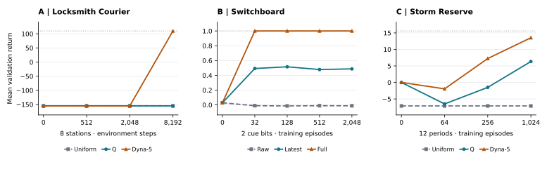

# Three environments, three failure modes

These games separate **planning**, **information**, and **adaptation to
chance**. A solved small example checks the intended rules before a harder
variant asks whether the learned policy actually works.

| Study | What changes? | What the run showed |
| --- | --- | --- |
| [Locksmith Courier](../../worlds/challenges/locksmith/README.md) | More doors compete for a limited number of bypass charges. | At 8,192 real interactions on the 8-station route, Dyna-Q delivered 256/256 held-out parcels at the optimal score (+110); plain Q delivered 0/256. |
| [Switchboard](../../worlds/challenges/switchboard/README.md) | A delayed query names which earlier cue mattered. | On two cues, raw / last-cue / full-memory Q scored −0.026 / +0.493 / +1.000. Their class ceilings are 0 / +0.5 / +1; with current-view policies, extra samples cannot reconstruct discarded cues. A history-aware agent could solve the raw game. |
| [Storm Reserve](../../worlds/challenges/storm-reserve/README.md) | Storage bounds and a deadline change what a forecast is worth. | At 1,024 episodes in the 12-period, four-unit market, frozen Q returned +6.82, Dyna-Q +14.60. The short-sighted controller is worth +9.05 and the optimal controller +15.58. |

Returns are undiscounted. Training replicates, not evaluation episodes, are
the independent units: Courier and Reserve each use eight, Switchboard uses
sixteen. Each comparison matches seeds across arms or observation variants.
Dyna uses five additional model backups per observed step, not equal compute.
No cross-game average or claim about other tasks is implied.



Points are means across frozen-policy validation blocks at each printed budget; horizontal spacing is by checkpoint, not linear time. The dotted line is the full-information optimum for each task. The held-out results above are separate. [Figure source](plot.py).

## Run one

Each command uses an explicit plan in the [experiment directory](../../experiments).
Choose a fresh output path. The first two commands below run the entire Storm
Reserve study and check its source, checkpoint chains and accounting. Use the
recorded Node version for the final replay.

```sh
node experiment.mjs run experiments/storm-reserve.json runs/reserve
node experiment.mjs verify runs/reserve
node runs/reserve/code/experiment.mjs replay runs/reserve reserve-12x4 dyna-5 0 1024 test 0
npm start -- --run runs/reserve
```

Use `experiments/locksmith-courier.json` or `experiments/switchboard.json`
for the other games. All three base plans were trained and opened in Studio;
for one real episode of each, MCP's seeded public frames matched archived
Bend replay frame-for-frame (155, 5 and 12 frames for Courier, Switchboard,
and Reserve). The generic observation canvas does not infer a board layout.

## What was measured

The three primary plans account for 144 trained trials and 624 sealed
checkpoints (48/192 Courier, 48/240 Switchboard, 48/192 Reserve).
Interrupted and uninterrupted archives matched checkpoint bytes on the
Courier and small Switchboard runs. These counts exclude follow-up
experiments and smoke tests. The [replicate results](results.json) record
the actual final scores, not just aggregates; rebuild with [results.mjs](results.mjs) using the Courier, Switchboard and Reserve archive directories in that order.

For a verified archive of one of the JSON studies, the following reads the
frozen **compiled Bend** preferred-action function for Q/Dyna and evaluates it
over the entire specified Markov probability model. Random uses exact U32
modulo buckets. This separates finite test-block sampling noise from the
quality of each learned controller. It is not a sweep over every possible
PRNG seed or a way to run an untrusted archive.

```sh
node studies/complex-worlds/frozen-values.mjs runs/reserve > frozen-values.csv
```

For the 12-period Reserve game the exact frozen-policy returns averaged
**6.714 for Q and 14.354 for Dyna**, versus held-out **6.818 and 14.597**.
Dyna minus Q on the held-out paired blocks: +7.778 with a descriptive
paired bootstrap 95% interval [+7.068, +8.553]. A single local, one-core
run including compilation and validation took 63.7 s and peaked at 447 MiB
sampled aggregate proportional memory; this is not a general speed claim.

## Beyond the primary plans

* **Courier:** On 12 fresh matched seed blocks at 8,192 steps, Dyna with zero planning backups matched vanilla Q and both timed out; five backups reached the optimum. By 49,152 steps all three were optimal. The 5,076-state variant still compiled, trained, resumed and verified; at 32,768 interactions all three arms scored −1,603 (no deliveries) versus the exact +948. Running a world is not the same as learning it.
* **Switchboard:** The explicit eight-cue compile was stopped by a 1.5 GiB proportional-memory guard. The [compact implementation](../../worlds/challenges/switchboard/switchboard.bend) ran the eight-cue study in 54 s at 299 MiB, and on the smaller encodings matched 30 seeded compiled replay pairs. At 16 cues, the compact world has 1,048,576 possible query contexts *without materializing them*. After 16,384 episodes, eight independent tabular models had visited 1.5504% on average, versus 1.5504% predicted under independent uniform contexts. All visited contexts were answered correctly. This is a sample-coverage result, not evidence that a rule-based or generalizing agent needs a million examples.
* **Storm Reserve:** The [offline overlap study](offline/README.md) uses the same twelve-period market to distinguish seeing similar behavior in a log from having statistical support for policy evaluation. Giving every action nonzero probability fixes support, but it does not guarantee useful sample size over twelve decisions.

## Optional larger run

[storm-factorial.mjs](storm-factorial.mjs) creates eight independent archives'
input plans: horizons 8/24 × capacities 2/8 × Q/Dyna. Within each world the
two arms use exactly matched fresh seeds. Checkpoints range from zero through
16,384 training episodes. Run a single cell before attempting all eight;
they are intentionally more expensive than the examples.

```sh
mkdir -p runs
node studies/complex-worlds/storm-factorial.mjs runs/reserve-design
node experiment.mjs run runs/reserve-design/reserve-8x2-q.json runs/reserve-8x2-q --until 256
node runs/reserve-8x2-q/code/experiment.mjs resume runs/reserve-8x2-q
```
