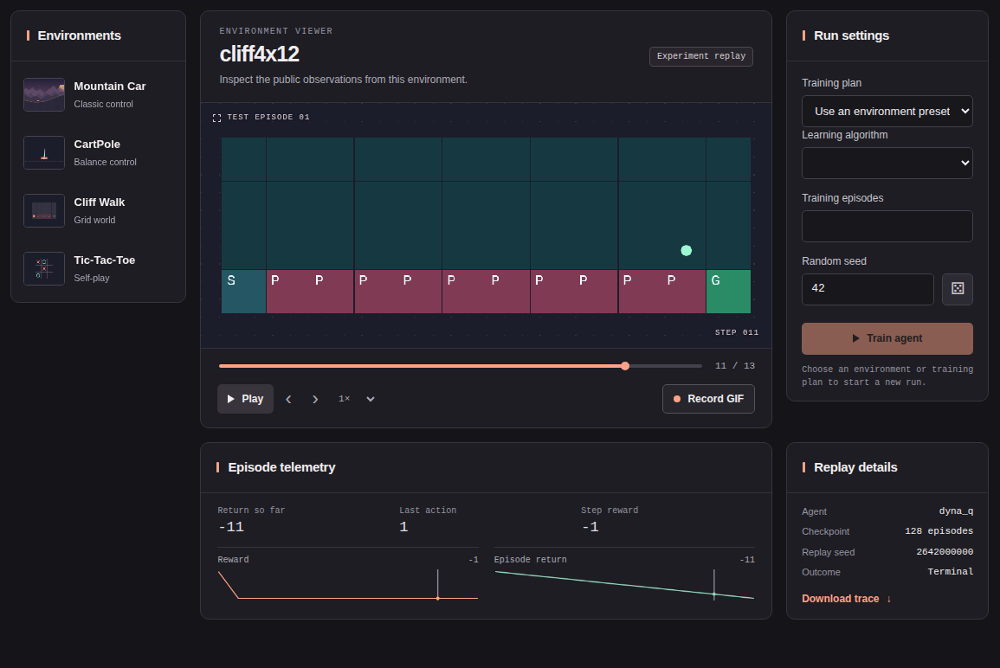

# Flagship toy-text study

A fixed-suite example of importing finite worlds, training with matched seeds, independently checking the run archive and reporting uncertainty. This is not a hyperparameter search or a ranking across reinforcement-learning problems in general.

## Design

- [Training manifest](../../experiments/flagship-toy-text.json): two 4×4 FrozenLake variants (slip and dry), the 4×12 CliffWalking port, and one-step noisy bandit probes with two and four actions. The horizons are 100, 100, 200, 1 and 1 respectively.
- Eight arms: uniform random, Q-learning, Expected SARSA, Double Q, Dyna-Q (five planning updates), SARSA, three-step expected TD, and tabular expected TD(λ), with λ = 0.8. The learning arms use α = 0.25, γ = 0.9 and a nominal 0.25 training exploration probability; the three custom learners use the shipped fixed-quarter policy. Evaluation is greedy except for the uniform baseline.
- Ten separate trained replicates per world and arm, with matched arm seeds and separate train/validation/test seed blocks. Budgets are 0, 8, 16, 32, 64 and 128 training episodes; validation uses eight episodes every time; the held-out test uses 16 episodes only at 128. No worlds or replicates were cut. This is an episode budget, not matched interaction count or compute cost.
- The two bandits probe immediate reward learning at low run cost; their inclusion gives that family two of five equally weighted games. IQM scales mean episode return using each game's exact uniform and finite-horizon optimal returns as 0 and 1, with no clamping. The [anchors](anchors.json) come from the existing [toy-text oracles](../../integrations/gymnasium/toy_text/baselines.json) and [probe oracles](../../worlds/benchmarks/probes/baselines.json), not fitted outcomes.

## Artifacts

- [Verified export](checkpoints.csv): 2,400 checkpoints from 400 trials. [Identity](identity.json) records the plan-file SHA-256, sealed manifest hash, and Node, Bend, backend and bundled source identities.
- [Validation return curve](validation-return.svg) and [validation terminal fraction](validation-completion.svg). A terminal state includes failures such as a hole in FrozenLake; do not interpret terminal fraction as task success.
- Per-game paired differences: validation versus [random](paired-validation-vs-random.csv) and [Q-learning](paired-validation-vs-q_learning.csv); test versus [random](paired-test-vs-random.csv) and [Q-learning](paired-test-vs-q_learning.csv).
- Aggregate IQM for [validation](iqm-validation.csv) and [test](iqm-test.csv); probability of improvement on validation versus [random](pi-validation-vs-random.csv) and [Q-learning](pi-validation-vs-q_learning.csv), and on test versus [random](pi-test-vs-random.csv) and [Q-learning](pi-test-vs-q_learning.csv).
- [Standalone report](report.html): download and open in a browser. It embeds tables and compact replay examples, not executable archived code.
- [Byte hashes](checkpoint-hashes.json): two files from the original run. The Linux CI slice reruns those trials from the unchanged full manifest (using one-trial shards), so their sealed manifest binding is also checked.

## Results and limits

At the held-out final checkpoint, Dyna-Q had the highest normalized IQM in this suite: **0.615** (95% interval 0.505–0.728), versus **0.576** (0.483–0.653) for Q-learning and **−0.001** (−0.017–0.029) for random. Its probability of improvement was **0.732** (0.685–0.785) versus random but only **0.510** (0.500–0.530) versus Q-learning. The other learning arms each reached 0.720 versus random. These estimates are descriptive, and the apparent Dyna-Q advantage over Q-learning is not a basis for a general ranking.

The intervals are 95% percentile intervals from 2,000 bootstrap resamples of trained replicate blocks. Suite PI averages, within each game, all cross-arm replicate pairs with ties counted as half; it is not the paired replicate win rate. Game membership stays fixed, and suite bootstrap samples the matched arm blocks within each game. These are pointwise estimates with no multiplicity adjustment. A tied estimate or zero-width interval can arise from discrete outcomes or identical choices in these seed blocks; it is not proof of identical policies. Small sample sizes, shared evaluation seeds across budgets, equal weighting of the two easy bandits, sparse FrozenLake reward and the short episode budget limit conclusions. Use independent seeds and a more diverse fixed suite to confirm any ranking.

## Inspect a learned route in Studio

After reproducing the archive below, attach it with `npm start -- --run runs/flagship-toy-text`. In **Experiments**, compare Q-learning, Expected SARSA and Dyna-Q on `cliff4x12` to see the [README comparison](../../README.md#design-an-experiment). The figure leaves out the uniform baseline so the differences among the three learning curves remain visible. Studio uses pointwise bootstrap intervals over ten trained replicates per arm.

Choose **Open replay**, then select `cliff4x12`, `dyna_q`, checkpoint **128**, replicate **1**, **test** and episode **1**. At step 11 the agent is above the cliff and two moves from the goal. This held-out episode ends after 13 moves with return −13; one replay illustrates the route, not the variability across seeds.



## Reproduce

Run from the repository root with Bend 2.0.40 and Node 24.22.3. For the figures activate an isolated Python environment with Matplotlib (the committed charts were made with Python 3.14.7 and Matplotlib 3.11.2; numerical analyses are standard-library only). Output directories must not exist. Do not commit the run archive.

```sh
node experiment.mjs validate experiments/flagship-toy-text.json
node experiment.mjs run experiments/flagship-toy-text.json runs/flagship-toy-text --jobs 4
node experiment.mjs verify runs/flagship-toy-text
bash studies/flagship-toy-text/render.sh runs/flagship-toy-text flagship-export
node checks/flagship_slice.mjs
```

`render.sh` defaults to `python3`; set `PYTHON` to the path of the plotting environment if needed. Confirm the regenerated sealed identity and checkpoint export against the committed copies. SVG metadata/layout can differ with the plotting version or fonts. The archived run can be replayed in Studio; use a fresh output path when creating another run.
