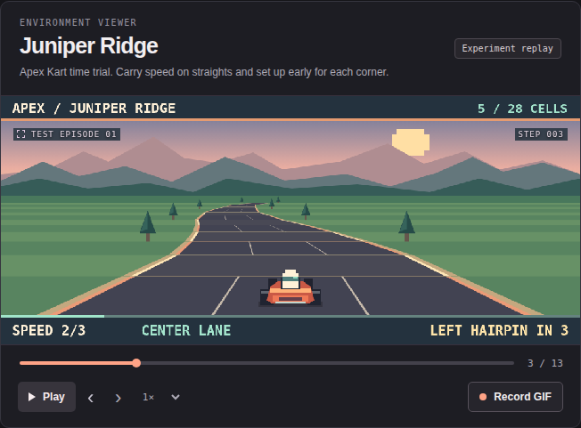

# Apex Kart

Carry speed down a straight, turn into the apex, then decide whether you can reach the next hairpin without braking. Apex Kart is an original, **turn-based time trial** for tabular agents and human drivers. No game installation, commercial assets or GPU needed. The road and kart in Studio illustrate a public finite world; this is not a 3-D physics engine, multiplayer race, or vision benchmark.



## Drive a lap

You start at speed 1. **Choose one input per tick:** **0** coast (keep speed and line), **1** throttle (+1 speed), **2** brake (−1 speed), **3** steer left one lane, **4** steer right one lane. Inputs clamp at the limits; steering does not automatically slow you down. The kart travels one cell per unit of speed, up to three. The game checks *every* cell you cross, even on a three-cell straightaway.

| Tile | Comfortable at any lane | With the inside line |
| --- | --- | --- |
| `.` straight | All speeds | No advantage |
| `l` / `r` left / right sweeper | Speeds 1–2 | Take it at 3; drift out to center |
| `L` / `R` left / right hairpin | Speed 1 | Take it at 2; drift out to center. Speed 3 always runs wide. |

If you enter too fast without enough grip, you reach that cell, run onto the **outside lane**, lose the rest of the tick, and leave at speed 1. You can recover on your next turn. Your lap score is **cells completed − ticks − 4 × gravel incidents**. Every input progresses at least one cell. All drivers finish within the course length, so *finishing alone* does not distinguish good driving. Score rewards shorter, cleaner laps without rewarding time spent circling.

The two published tracks:

* **[Quarry Sprint](kart-sprint.json)**: 9 cells, `...L..r..`, center grid. The optimal four inputs are throttle, steer left, steer right, throttle (score **5**). After three ticks at most 2 + 3 + 3 = 8 cells are possible, even on a straight. This certifies optimality independently of the solver.
* **[Juniper Ridge](kart-ridge.json)**: 28 cells, `....l..L...r.r..R....l.r....`, equal left/right grid. The full optimum from either grid is **16**. The best achievable mean without brakes falls to **15**; without steering it falls to **14**. Blind throttle scores −1 / −6 from left / right. Identical resets and actions produce identical laps.

**Studio plays back laps; its Play button does not steer the kart.** To drive directly with [MCP play](../../../mcp/README.md#play-a-finite-world), call `env_reset` with a track's workspace-relative JSON path, a seed and the track length as the limit, then `env_step` with a listed action. **Observation 0 is the finish.** Otherwise, let `n = observation − 1`: cells already completed = ⌊n/9⌋, lane = ⌊n/3⌋ mod 3 (left, center, right), and speed = 1 + n mod 3. The next tile is the road string indexed by cells completed, starting at zero. The [world module](kart.mjs) exports this decoder, the course maps and the transition generator. State row IDs in the JSON table are *not* observation IDs.

## What learned to drive?

Undiscounted final scores from the [36-trial study](../../../experiments/apex-kart.json) at **8,192 real interactions**. Scripted reads the next bend and chooses whether to brake, steer or accelerate; it is a fallible [hand-coded driver](driver.mjs), not a human demonstration or the oracle. The exact columns average both opening lanes on Ridge.

| Track | Exact optimal / scripted / uniform | Held-out random | Held-out Q | Held-out Dyna-Q |
| --- | ---: | ---: | ---: | ---: |
| Sprint (41 reachable states incl. finish) | 5 / 3 / −0.011 | 0.031 | 4.333 | 4.833 |
| Ridge (169 reachable states incl. finish) | 16 / 13 / 1.569 | 1.729 | 13.125 | 14.516 |

At 512, 2,048 and 8,192 steps Ridge Dyna-Q validation means were 9.90, 12.96 and 14.45. At the last checkpoint the six independently trained policies scored 15.00, 14.44, 15.00, 14.00, 14.00 and 14.66 on their held-out blocks. Weight both possible starting lanes equally rather than sampling a block and those same policies average **14.50**. None matched a perfect 16 from both grids; this is learning a useful racing line, not solving all courses. Dyna uses five extra planning backups per observed transition, not equal compute. The six seed blocks are the independent training replicates; the 32 test episodes per policy are not 32 more fits. These seeds vary starts (and learner exploration), **not track geometry**. This study does not test transfer to unseen tracks.

## Reproduce and watch

From the repo root with the pinned Node 24.22.3 and Bend 2.0.40:

```sh
node worlds/challenges/apex-kart/generate.mjs --check
node --test worlds/challenges/apex-kart/checks.mjs
node experiment.mjs oracle worlds/challenges/apex-kart/kart-ridge.json 28
node experiment.mjs run experiments/apex-kart.json runs/kart
node experiment.mjs verify runs/kart
node experiment.mjs export runs/kart > kart.csv
node runs/kart/code/experiment.mjs replay runs/kart kart-ridge dyna-5 0 8192 test 0
npm start -- --run runs/kart
```

The [reference export](results.csv) has 144 checkpoint rows (two worlds, three arms, six replicates, four budgets). For exact frozen-policy values on both start lanes use `node studies/complex-worlds/frozen-values.mjs runs/kart`. On one CPU core the example study, including compilation and evaluation, took about 24 s and peaked around 1.42 GiB sampled group PSS; these are machine-specific measurements.

In Studio choose **Experiments → Open replay → kart-ridge / dyna-5 / 8192 / Test / Episode 1**, then use Next, Previous, the scrubber or Record GIF. Replicate 0's first held-out lap scores **15 in 13 ticks with no gravel**. Both tracks render only for a matching definition with the original observations; modified geometry or history-encoded observations retain generic replay. Four matched MCP protocol rollouts (both courses, both Dyna-Q and random) matched their compiled Bend replays frame for frame.
